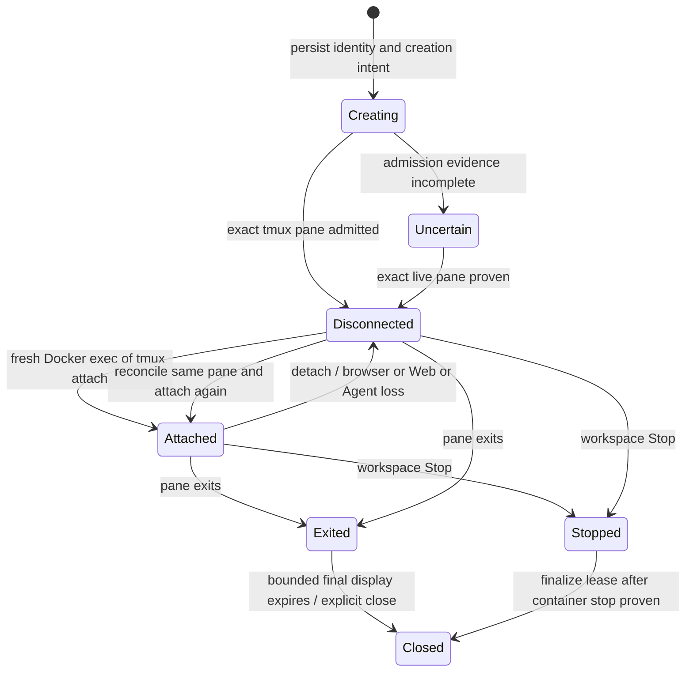

# ADR 017: Persist workspace terminals with tmux

- Status: Accepted
- Date: 2026-10-13
- Baseline: `ce721c990a0871088b98abe36f68b6cebe5a5edb`
- On acceptance, supersedes ADR 016's restart-loss behavior for new persistent Native PTYs
- Preserves ADRs 002, 003, 005, 006 and Native identity/home contracts in ADR 016

## Context and decision

Today the Agent retains Docker exec identity on disk, but owns the only PTY transport and
64 KiB output tail in memory. Restart loses the transport and screen; a Native harness can
remain running with its private-home lease held, yet cannot be reattached. Provider Resume
starts another process generation and does not solve this problem.

Use a dedicated tmux server **inside each development container**, under its configured
execution UID, with one single-pane session per terminal process generation. Tmux owns the
child PTY, current screen, cursor and bounded history. The Agent owns admission, exact
workspace/container identity and temporary tmux clients. Web remains the only SQLite writer.
No host service, extra mount, container privilege, network listener or shell command bridge
is needed. Structured Legacy AI and noninteractive tasks keep their current execution path.

Unknown ownership or availability stays uncertain; it does not authorize a new launch.

## Integration contract

| Operation | Required behavior |
| --- | --- |
| Create | Web reserves IDs first. Agent persists the exact runtime binding and deterministic tmux session name before side effects. Launch once, detached, at 80×24; retain dead panes from the outset. |
| Attach | Revalidate container ID, workspace runtime generation/revision/plan, execution UID, session and pane. Create a **new** Docker exec client; never attempt to reopen the original exec stream. |
| Detach | End only this client/attachment. Child, screen, history, session generation and home lease continue. Tab removal is detach. |
| Resize | Resize the current attachment's Docker exec TTY; tmux propagates geometry to its pane. Use the latest client's size, retain the last size while detached, bound browser geometry to 240×100. |
| Exit | Observe `pane_dead` and exit status/signal on the exact retained pane, persist once and settle the matching Native generation once. A client EOF/exit is only transport loss. |
| Explicit close | For shells, durably mark closing, kill only the exact tmux session and retire it idempotently. This closes the terminal, not a promise to kill every detached descendant. For live Native harnesses, retain today's force-close refusal: exit through the CLI or Stop the workspace. Closed Native display sessions can be removed. |
| Workspace Stop | Fence attachments/admissions, stop the exact container, then mark its terminals stopped/closed with unknown exit code where needed and finalize Native homes. A failed/unproven Stop retains the lease. Start creates no replacement terminal automatically. |

**Identity and retry.** Stable identity is the Web terminal/process ID plus Agent-held project,
workspace, exact container ID, runtime generation and configuration hashes. Native additionally
pins DevSpace session ID, process generation, definition digest and lease ID. Persist tmux
session/pane IDs and a backend version with this binding. Docker creation/query exec IDs are
operation evidence; attachment UUID and attach exec ID are temporary and never process identity.
Set nonsecret identity markers as session environment in the same `new-session` command that
creates the pane; subsequently record its returned pane ID. Query only against a matching
Agent-private record: same-name resources or markers alone never authorize adoption.

Serialize creation by stable identity. After a timeout/restart, query the exact session and
retained creation exec before retrying: a live **or dead** matching pane means already launched.
Never use `new-session -A`, `respawn-pane`, provider Resume or an automatic second launch to
repair attachment failure. If a pending creation cannot be proved completed or never started,
retain uncertainty and the home lease until exact evidence or workspace Stop resolves it.
Existing direct-exec terminals cannot be converted live; their existing loss/Stop recovery
continues until exited. Only newly admitted persistent terminals get this contract.

**Transport and input owner.** Use the existing Engine Unix socket operations: exec create
with structured `Cmd`, attached TTY start, resize and inspect; fixed non-TTY tmux queries supply
pane observations. Launch argv directly through tmux; its single-command-argument form invokes
a shell, so use a tiny packaged `exec-argv` launcher to preserve even zero-argument harness argv
without shell evaluation. It immediately execs the approved program; it is not a daemon or a
browser-accessible command service. Bootstrap the shared server
from a controlled container baseline before adding harness variables: tmux inherits its creator's
environment globally. Supply `CODEX_HOME` and custom harness variables only to their intended
session. Disable attach-time environment updates; attaching must not change provider environment.

Keep one Agent attachment reservation before upgrade. A second browser gets a clear
“already attached” state; it does not steal input or retry indefinitely. The Web relay maps Agent
HTTP 409 into the versioned attachment-conflict WebSocket frame because browser WebSocket APIs hide
upgrade HTTP status. Other availability checks continue to use authenticated terminal status.
Heartbeat both relay legs (15-second ping, 30-second expiry); expire only the attachment so a
silent connection cannot hold the input reservation forever. After Agent restart,
`attach-session -d` may evict an abandoned tmux client only after exact ownership validation and
reservation. Input and resize are accepted only from the reserved active socket; stale cleanup
cannot detach its successor. The ready frame carries the attachment UUID so the browser can ignore
late frames from older sockets. Web restart drops its relay, then a new relay attaches the same
terminal. Agent startup recovers sessions as disconnected; browser reload/temporary loss
reconnects by ID with bounded retries and a manual Reconnect action after exhaustion.

**Screen and scrollback.** Introduce a versioned terminal attachment handshake: `ready` carries
an attachment UUID and requires xterm reset, including history, on **every** connection. Register
the stream reader before consuming output, bound any initial queue, deliver `ready` first,
then forward the new tmux client's ordered redraw/live byte stream. Chunk at the existing
65,536-byte payload limit. Resize again after ready, even when dimensions have not changed.
No old 64 KiB raw tail or separately captured visible screen is prepended: tmux redraw is the
snapshot, and tmux orders subsequent updates on that same stream. Late frames from old sockets
are ignored. There is no custom snapshot/live sequence protocol to maintain.

Retained history lives in tmux, **not xterm's browser-local scrollback**. Provide a visible
History / Return to live control, mapped by the Agent to fixed copy-mode/cancel commands on the
owned pane. Tmux copy mode provides history navigation; xterm renders that view and its browser
selection/copy support remains available for selecting visible text. Keep tmux mouse capture off
so browser selection works. Disable the normal prefix, status bar and unrelated root bindings.
Preserve copy-mode navigation. Ordinary browser scrolling after reload is not the restored-history
interface. Alternate-screen applications retain their current screen; history contains lines
tmux actually retained, not every earlier TUI frame. This product tradeoff requires owner review.

Set history to 2,000 lines per pane and bound geometry and terminal count (initially 8 per
workspace). Container memory/PID limits remain the final resource bound. Keep 256 KiB relay/input
queue thresholds; add no unbounded snapshot queue or durable output log. The current relay lacks
end-to-end xterm-consumption acknowledgements and may disconnect slow clients. Disconnect and
redraw again without terminating the pane; output older than retained history can be evicted.
Keep final dead-pane display available for the existing 30-second read-only window, then clean
it up. In v2, `exit` disables input but does not immediately dispose xterm or close the relay:
final redraw output may still arrive during that window. Web terminal-state refresh must also
preserve this read-only display. Do not destroy exit evidence before durable settlement.

**Native homes and SQLite.** Reattachment retains the original process, generation, native
thread identity/baseline, definition digest, dirty slot and exclusive private-home lease. Never
materialize, discover a different thread, write back or release on attachment loss. A live pane
keeps the Native session `active` even when its terminal is `disconnected`; Resume stays false.
Exact pane death runs existing foreground settlement and canonical Codex ID discovery. Missing
server/socket or failed query while the container runs is unproven process loss: retain the
lease and require recovery/Stop, rather than inferring exit from the tmux client exec.

Extend existing Agent snapshots with exact persistent-process observations. On Web restart or
Agent reconnection, Web reconciles existing terminal/process/Native rows transactionally using
matching IDs and generation; it issues no launch. Connectivity alone must not project `lost`,
set `closedAt`, or trigger the 30-second lost-row pruning. Reconcile successful admissions whose
response was lost back to the existing `creating` row. Reject observations for old generations
and prevent stale snapshots from reviving closed rows. Changes stay within these projection and
admission methods; no broad `database.ts` or AI architecture refactor.

## Binary delivery and alternatives

The current runtime supports image references, including `node:24-bookworm`; Dockerfile sources,
setup steps and sudo are not implemented. Never require runtime apt installation or assume tmux
exists. Package a pinned Linux amd64 static tmux closure with terminfo (`xterm-256color` and
`tmux-256color`), controlled config and the argv launcher. Stage and verify it using the existing
Docker archive/native-helper pattern into the container writable layer. Prepare a UID-owned
0700 socket directory outside `/workspace` and the harness home. Use one version for server and
clients; probe executable, terminfo, UID access and socket creation before admission. Unsupported
images/platforms get an actionable capability error before acquiring a home lease. No silent
fallback to a terminal advertised as persistent. Reuse licenses and pinned digests; do not fetch
“latest” during workspace Start. Arm64 and musl image acceptance can follow when needed.

A purpose-built in-container PTY daemon could provide screen snapshots and browser scrollback
serialization, but would require process supervision, terminal emulation, ordering, lifecycle
and protocol code that tmux already supplies. Reject it for this milestone. Also reject tmux
control-mode plus a new Agent screen emulator, raw-output replay as screen recovery, and provider
Resume as live-process recovery. Revisit only if the native attach/history interface fails
practical browser acceptance. The t3code comparison is recorded in the feasibility report.

## Evidence, risks and delivery slices

[Feasibility report](../feasibility/persistent-terminals-2026-10-13.md): local tmux 3.4 and the
static 3.7c artifact preserved shell/TUI PIDs, redraw, cursor, resize, input and history through
client loss. PR #75 passed its rootless Docker feasibility gate for both target Debian images.
Slice 1 implements ordinary shells and extends that existing Docker acceptance test through the
production Agent manager across manager reinitialization. Full Agent/Web process restart and
browser acceptance remain unverified delivery gates. Main risks are image/UID/terminfo coverage
and TUI key/display compatibility. Tmux server/container death loses live state; persistence
covers Web/Agent/browser loss while the container keeps running. Rare ambiguous admission and
hostile same-container mutation keep conservative recovery; perfect crash recovery, multi-owner
fencing and full browser history serialization are deferred.

1. **Persistent shell slice:** binary delivery, exact identity/admission and Agent recovery;
   browser attach/reset/resize, History control and single input owner. Prove a running shell
   survives Agent/Web restart and reload using disposable rootless Docker. Provisioning and
   authority failures block admission; speculative hardening does not block this slice.
2. **Native continuity slice:** use the same backend for Native harnesses, retain generation and
   lease across recovery, and update narrow Web projections. Prove the same live Codex process
   and session continues; preserve Legacy and old direct-exec recovery.
3. **Exit/Stop slice:** durable pane exit, final display retention, shell close, restart during
   settlement and workspace Stop/Start. Prove home writeback/release happens once and Stop leaves
   no attachable old process; document Native force-close behavior in the UI.
4. **Acceptance slice:** focused restart/disconnect/duplicate-owner/slow-client checks and browser
   acceptance. Start a shell and Native Codex, restart Agent and Web, reload, and reattach with
   unchanged underlying PIDs and Native generation, restored screen and usable retained history.
   Codex must continue the same live session. Then Stop, verify no live old processes/attachments
   and safe home settlement; Start must not silently resurrect them.

Each slice is separately reviewable. Slice 1 implements persistent ordinary shells and browser
recovery. Native continuity and full exit/close settlement remain deferred to Slices 2 and 3.
The required full Agent/Web restart acceptance remains a delivery gate for the Slice 1 PR.
